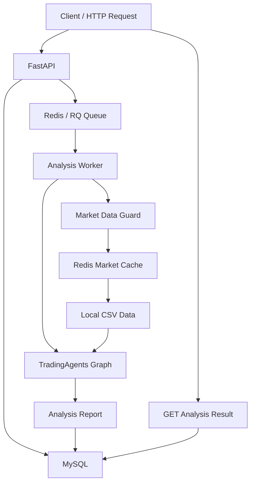

# TradingAgents — FastAPI Backend Extension

为开源多智能体金融交易框架 [TradingAgents](https://github.com/TauricResearch/TradingAgents) 扩展的 Python 后端系统。

本项目基于原有 TradingAgents 框架，增加 FastAPI REST API、MySQL 任务持久化、Redis 缓存、RQ 异步任务队列以及 Docker Compose 部署能力，实现股票分析任务的 API 化和异步执行。

## 1. 项目介绍

TradingAgents 是一个基于多智能体协作的金融分析框架。本项目在其基础上开发独立的后端服务，使股票分析能够通过 HTTP API 提交，并由后台 Worker 执行。

主要解决的问题：

- 将原有股票分析能力封装为 REST API。
- 使用 Redis + RQ 实现耗时分析任务的异步执行。
- 使用 MySQL 持久化分析任务和分析报告。
- 使用 Redis 缓存本地市场行情，减少重复数据读取。
- 增加行情数据质量校验，避免在历史数据不足时调用大模型。
- 使用 Docker Compose 统一管理 API、Worker、MySQL 和 Redis。

## 2. 技术栈

| 技术 | 用途 |
|---|---|
| Python 3.12 | 后端开发语言 |
| FastAPI | REST API 服务 |
| Pydantic | 请求参数校验 |
| SQLAlchemy | ORM 和数据库操作 |
| MySQL 8.4 | 分析任务和报告持久化 |
| Redis 7 | 缓存和任务队列 |
| RQ | 后台异步任务调度 |
| Pandas | 行情数据处理和技术指标计算 |
| TradingAgents / LangGraph | 多智能体股票分析 |
| Docker | 容器化部署 |
| Docker Compose | 多服务编排 |
| Pytest | 自动化测试 |

## 3. 系统架构



### 核心执行流程

1. 客户端通过 FastAPI 提交股票分析请求。
2. API 在 MySQL 中创建分析任务。
3. API 将任务提交到 Redis 的 analysis 队列。
4. RQ Worker 获取任务并更新任务状态。
5. Worker 检查本地历史行情是否满足分析要求。
6. 加载本地行情数据源并调用 TradingAgents Graph。
7. TradingAgents 执行股票分析并生成报告。
8. Worker 将分析结论、报告和任务状态保存到 MySQL。
9. 客户端通过任务 ID 查询分析结果。

## 4. 核心功能

### 4.1 FastAPI REST API

提供股票分析任务提交、历史任务查询和分析报告查询接口。

- 使用 Pydantic 校验请求参数。
- 使用 UUID 标识分析任务。
- 支持同步和异步分析接口。
- 提供统一的 HTTP 错误响应。

### 4.2 MySQL 任务持久化

使用 SQLAlchemy ORM 管理分析任务。

核心数据表：

`analysis_tasks`

主要字段：

| 字段 | 说明 |
|---|---|
| id | 自增主键 |
| task_id | 任务 UUID |
| ticker | 股票代码 |
| analysis_date | 分析日期 |
| status | 任务状态 |
| decision | 分析决策 |
| report | 分析报告 |
| error_message | 错误信息 |
| created_at | 创建时间 |
| updated_at | 更新时间 |

### 4.3 Redis + RQ 异步任务

将耗时的股票分析任务从 API 请求处理中分离。

执行流程：

- FastAPI 创建任务记录。
- RQ 将任务放入 Redis 队列。
- Worker 独立消费 analysis 队列。
- Worker 执行 TradingAgents 分析。
- 分析结果保存至 MySQL。

任务状态包括：

- pending
- running
- completed
- failed
- data_unavailable

### 4.4 Redis 行情缓存

实现本地行情数据的 Redis 缓存。

主要机制：

- 首先查询 Redis。
- 缓存命中时直接返回数据。
- 缓存未命中时读取本地 CSV。
- 有效数据写入 Redis。
- 默认缓存 TTL 为 3600 秒。
- Redis 缓存异常时回退到本地 CSV 读取。

### 4.5 本地市场数据与技术指标

使用本地 Alpha Vantage 历史 OHLCV CSV 数据，为 TradingAgents 注册自定义数据源。

支持的技术指标：

- SMA 20
- SMA 50
- EMA 10
- RSI 14
- MACD
- MACD Signal
- MACD Histogram

本地数据源通过 TradingAgents 原有工具接口提供：

- get_stock_data
- get_indicators
- get_verified_market_snapshot

### 4.6 行情数据质量保护

在调用大模型之前检查历史行情数据。

主要校验：

- 股票代码是否受支持。
- 行情文件是否存在。
- 行情字段是否完整。
- 是否存在空值和重复日期。
- OHLC 价格关系是否合理。
- 是否存在未来数据。
- 分析日期是否存在对应行情。
- 历史数据是否达到至少 200 个交易日。

当行情数据不满足要求时，任务标记为 `data_unavailable`，避免继续调用大模型。

### 4.7 任务状态恢复

提供任务状态 reconciliation 脚本。

通过对比 MySQL 任务状态和 Redis RQ Job 状态，识别明确失败的后台任务，并修复对应的 MySQL 任务状态。

运行方式：

```powershell
python -m backend.scripts.reconcile_tasks
```

该脚本目前为手动执行，不代表已经配置自动定时调度。

## 5. API 接口

默认服务地址：

`http://127.0.0.1:8002`

Swagger 文档：

`http://127.0.0.1:8002/docs`

| Method | Endpoint | 功能 |
|---|---|---|
| GET | `/health` | 服务健康检查 |
| POST | `/api/v1/analyses` | 异步提交股票分析 |
| GET | `/api/v1/analyses` | 查询最近 20 条分析任务 |
| GET | `/api/v1/analyses/{task_id}` | 查询任务详情和分析报告 |
| POST | `/api/v1/analyses/run` | 同步执行股票分析 |
| POST | `/api/v1/demo-jobs` | 提交模拟异步任务 |
| GET | `/api/v1/demo-jobs/{job_id}` | 查询模拟任务状态 |

### 异步提交股票分析

Request:

```http
POST /api/v1/analyses
Content-Type: application/json
```

```json
{
  "ticker": "AAPL",
  "analysis_date": "2026-11-10"
}
```

Response:

```json
{
  "task_id": "your-task-uuid",
  "ticker": "AAPL",
  "status": "pending",
  "message": "股票分析任务已提交"
}
```

### 查询分析报告

```http
GET /api/v1/analyses/{task_id}
```

Response 示例：

```json
{
  "task_id": "your-task-uuid",
  "ticker": "AAPL",
  "analysis_date": "2026-11-10",
  "status": "completed",
  "decision": "Hold",
  "report": "完整股票分析报告",
  "error_message": null
}
```

## 6. 项目目录

```text
TradingAgents/
│
├── backend/
│   ├── core/
│   │   ├── database.py
│   │   ├── queue.py
│   │   └── redis_client.py
│   │
│   ├── models/
│   │   └── analysis.py
│   │
│   ├── scripts/
│   │   ├── calculate_indicators.py
│   │   ├── check_graph_vendor.py
│   │   ├── check_market_data.py
│   │   ├── reconcile_tasks.py
│   │   └── test_*.py
│   │
│   ├── services/
│   │   ├── indicators.py
│   │   ├── local_market_setup.py
│   │   ├── local_snapshot.py
│   │   ├── local_stock.py
│   │   ├── local_vendor.py
│   │   ├── market_cache.py
│   │   ├── market_guard.py
│   │   └── task_reconcile.py
│   │
│   ├── tasks/
│   │   ├── analysis_task.py
│   │   └── demo_task.py
│   │
│   ├── tests/
│   │   ├── test_api.py
│   │   ├── test_market_cache.py
│   │   ├── test_market_guard.py
│   │   ├── test_reconcile.py
│   │   └── test_worker.py
│   │
│   ├── data/                 # 本地行情数据，不提交 Git
│   ├── main.py
│   └── worker.py
│
├── tradingagents/             # 原始 TradingAgents 框架
│
├── Dockerfile.backend
├── compose.backend.yaml
├── .env.example
├── .gitignore
└── README.backend.md
```

## 7. 环境配置

### 环境要求

- Python 3.11+
- Docker Desktop
- Docker Compose
- Git

### 配置环境变量

复制环境变量模板：

```powershell
Copy-Item .env.example .env
```

在 `.env` 中填写实际使用的 LLM Provider API Key，并增加后端数据库配置：

```dotenv
# LLM Provider 示例
DEEPSEEK_API_KEY=your_deepseek_api_key

# MySQL
MYSQL_USER=root
MYSQL_PASSWORD=your_mysql_password
MYSQL_DATABASE=tradingagents_db
```

根据实际使用的模型提供商，配置对应的 Provider 和模型参数。

注意：

- `.env` 不应提交到 Git。
- 不要在 README、截图或公开仓库中暴露 API Key 和数据库密码。
- Docker Compose 内部使用 `mysql` 和 `redis` 作为服务地址。

## 8. Docker 部署

### 8.1 检查 Compose 配置

```powershell
docker compose -f compose.backend.yaml config --quiet
```

### 8.2 构建后端镜像

```powershell
docker compose -f compose.backend.yaml build api
```

### 8.3 启动 MySQL 和 Redis

```powershell
docker compose -f compose.backend.yaml up -d mysql redis
```

### 8.4 初始化数据库表

```powershell
docker compose -f compose.backend.yaml run --rm --no-deps api python -c "from backend.models.analysis import Base; from backend.core.database import engine; Base.metadata.create_all(bind=engine); print('Database initialized')"
```

### 8.5 启动 API 和 Worker

```powershell
docker compose -f compose.backend.yaml up -d api worker
```

### 8.6 查看服务状态

```powershell
docker compose -f compose.backend.yaml ps
```

预期包含：

- mysql
- redis
- api
- worker

### 8.7 健康检查

```powershell
Invoke-RestMethod http://127.0.0.1:8002/health
```

预期结果：

```json
{
  "status": "ok"
}
```

### 8.8 查看接口文档

浏览器打开：

http://127.0.0.1:8002/docs

### 8.9 查看日志

```powershell
docker compose -f compose.backend.yaml logs --tail=100 api worker
```

停止服务：

```powershell
docker compose -f compose.backend.yaml down
```

注意：不要随意使用 `down -v`，它会删除 Compose 管理的持久化数据卷。

## 9. 本地行情数据

本地行情文件：

```text
backend/data/aapl_ohlcv.csv
```

需要包含以下字段：

```csv
timestamp,open,high,low,close,volume
```

当前本地实现主要支持 AAPL。

真实异步分析任务要求：

- 至少 200 个历史交易日。
- 包含请求的分析日期。
- 不允许使用分析日期之后的数据。

本地 CSV 文件不会随 Git 仓库一起上传，需要使用者自行准备数据。

行情数据来源为 Alpha Vantage 日线 OHLCV。当前数据为本地校验，并不代表独立第三方验证。

技术指标生成：

```powershell
python -m backend.scripts.calculate_indicators
```

输出：

```text
backend/data/aapl_indicators.csv
```

注意：目前部分指标尚未实现，例如布林线上下轨、ATR 和 VWMA，不应将缺失值当成真实计算结果。

## 10. 自动化测试

运行后端测试：

```powershell
python -m pytest backend/tests/ -v
```

测试覆盖：

| 测试模块 | 测试内容 |
|---|---|
| test_api.py | 健康检查、参数校验、任务不存在 |
| test_market_cache.py | 缓存命中、缓存未命中、Redis 故障、异常数据不缓存 |
| test_market_guard.py | 历史数据要求、股票支持范围 |
| test_reconcile.py | 任务状态恢复 |
| test_worker.py | Worker 执行异常、历史行情不足保护 |

测试主要使用 Mock 和临时测试数据，不等同于完整的外部 LLM、真实市场数据端到端测试。

## 11. 当前项目限制

- 本地 CSV 数据源目前主要支持 AAPL。
- 真实异步分析要求至少 200 个历史交易日。
- 当前只配置了 Market Analyst 分析流程。
- 部分技术指标尚未实现。
- 任务状态恢复脚本需要手动运行。
- 当前没有独立的前端展示系统。
- 当前 API 尚未配置用户认证和权限控制，不应直接暴露到公网。

## 12. 后续优化方向

- 增加更多股票和市场数据源。
- 增加 Agent 执行过程和进度跟踪。
- 完善分析报告结构化存储。
- 增加用户认证与权限管理。
- 增加前端股票分析展示页面。
- 增加任务状态自动巡检机制。
- 完善生产环境部署和监控。

## Disclaimer

This project is for educational and research purposes only.

The generated analysis is not financial advice and should not be used as the sole basis for investment decisions.

## Author

GitHub: [uu725](https://github.com/uu725)

Repository: [TradingAgents](https://github.com/uu725/TradingAgents)

Backend branch: `feat/fastapi-backend`